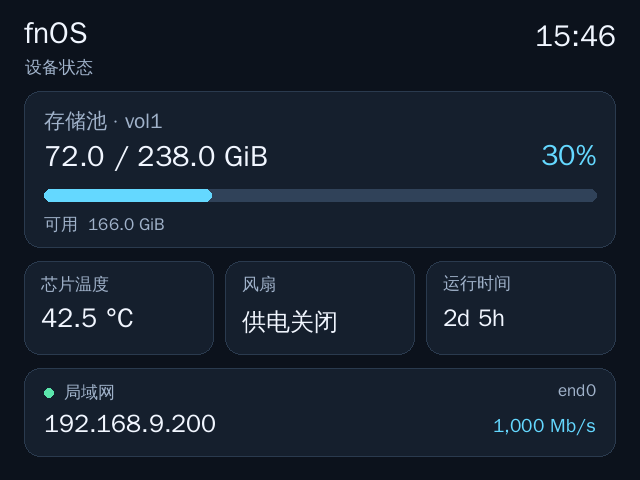

# 迅雷盒子 X1 · 飞牛固件与板级补丁

适用于迅雷盒子 X1（LSHZ_3399 / RK3399）的社区适配，基于飞牛 fnOS 和 [ophub/fnnas](https://github.com/ophub/fnnas)。

## 板载屏幕

上图由固件自带的状态页程序以 640×480 和示例数据生成。实体屏显示时间、存储池容量、芯片温度、风扇供电状态、运行时间、IP 和链路速率。

- 亮屏 10 分钟后自动熄屏。单击电源键切换亮灭，双击常亮，长按正常关机。
- 风扇在芯片达到 60°C 时供电，降到 55°C 时停止。读取温度失败时保持供电。

## 下载与安装

在 [Releases](../../releases) 下载固件 7z 或 DEB。校验文件为 `SHA256SUMS.txt`。

- **线刷**：解压 7z 后得到一个 IMG。若有多个分卷，把它们放在同一目录，从 `.001` 解压。用 RKDevTool 的「升级固件」选中 IMG。整包线刷会重建 eMMC 分区并替换现有系统和配置，请先备份。
- **现有飞牛系统**：DEB 适用于已经安装 `lshz-3399-peripherals` 和 `lshz-3399-board-services` 的 X1。在设备上运行 `sudo apt install ./lshz-3399-dsi-timing_0.2.beta3+fix1_arm64.deb`，完成后正常重启。

## 内核与实测

- 线刷包默认启动 `6.12.41-trim`。飞牛官方升级可以安装 `6.18.18.c1202-trim`，两套显示适配已随包提供。
- 保留中文卡片状态页。板上已验证 6.18 断电冷启动及时间、温度刷新。公开版在打包阶段做离线解包与校验，尚未实机线刷。
- 首次使用请通过飞牛 Web 向导创建管理员。SSH 启动时生成设备自己的主机密钥。

6.18 使用板级 initramfs 钩子，将定制的 DRM、DSI 和面板驱动放入启动镜像。状态页在 6.18 上通过 fbdev 写入刷新。若升级后黑屏，可用 `uname -r` 确认实际内核，并用 `sudo dmesg | grep -E 'panel initialization|panel power mode|command FIFO'` 检查面板初始化。正常 LP 初始化的回读为 `0x9c`。

构建与更新流程见 [BUILD.md](BUILD.md)。
